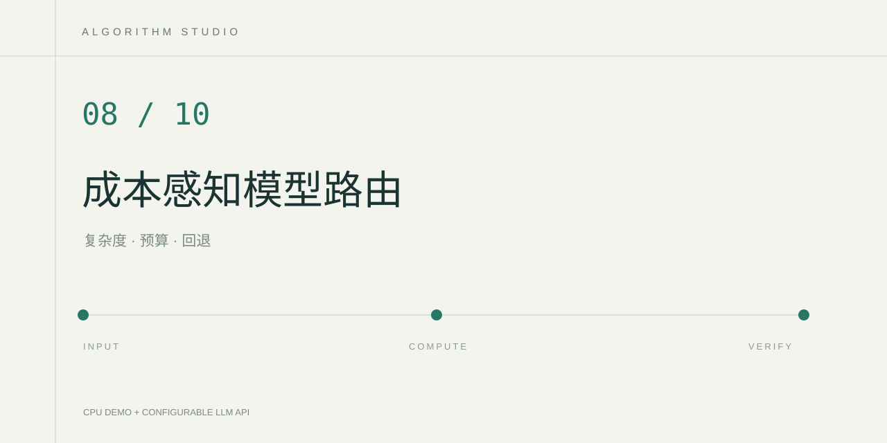

# RouteCraft 成本感知模型路由



输入自然语言问题和可选美元预算，程序根据启发式复杂度、估算费用和熔断状态选择模型。请求失败时在剩余估算预算内尝试另一个可用模型。

## 实现

- 问题长度、比较、多步推导、代码等显式信号决定 cheap/strong 的优先级。
- 请求前按字符数估算输入长度，结合 400 token 输出预算与用户配置的费率计算请求估算费用。
- SQLite 保存每个 API 提供方内模型的连续失败状态，连续失败两次后熔断 60 秒，成功后清零。
- 候选去重，最多尝试两个不同模型。失败请求也保守占用本次估算预算，避免无限回退。
- 页面展示路由理由、候选模型、预算、熔断状态和真实调用日志。

## 在 PyCharm 运行

使用 Python 3.12 并安装本目录 requirements.txt，运行 app.py。默认本地模式只执行路由算法，页面中的模型名与费率是假设参数，没有模拟模型回答、真实时延或收费记录。

示例输入的第一行为 `预算USD=0.002`，下一行填写问题。不填首行时不限定估算预算。

## 云端配置

在 .env 设置公共的 LLM_API_KEY、LLM_BASE_URL、LLM_MODEL，并按所用服务填写以下可选配置。费率单位均为美元每百万 token。

```dotenv
ROUTER_CHEAP_MODEL=填写同一服务支持的经济模型名称
ROUTER_STRONG_MODEL=填写同一服务支持的高能力模型名称
ROUTER_CHEAP_INPUT_PER_1M=填写实际费率
ROUTER_CHEAP_OUTPUT_PER_1M=填写实际费率
ROUTER_STRONG_INPUT_PER_1M=填写实际费率
ROUTER_STRONG_OUTPUT_PER_1M=填写实际费率
```

没有分别设置模型名称时，两档都使用 LLM_MODEL，相同名称只请求一次。显式设置预算时，缺失费率的模型不会入选。未知价格不填造数字，可先移除预算运行并查看实际响应 usage。

## 验证

运行 `python -m unittest discover -s tests`，或用 PyCharm 的 unittest 运行配置选择 tests。测试覆盖预算排除、真实调度逻辑中的失败回退、累计估算预算、熔断和恢复。

整理固定任务集后，可以记录路由选择、实际 token usage、成功率和时延，并由人工核对回答质量。项目没有预填性能提升或成本节省数据。

## 边界

当前复杂度是可解释启发规则，cheap/strong 需要根据任务集验证。字符估算、输出预算与实际计费可能不同，供应商的推理 token 和缓存计费也可能影响账单。这里的预算约束针对请求前估算，不是账户硬性消费上限。

## 参考

- [LiteLLM Router 的路由与回退设计](https://docs.litellm.ai/docs/routing)
- [Python sqlite3](https://docs.python.org/3/library/sqlite3.html)

实现使用标准库组织有限调用链，没有依赖 LiteLLM。
